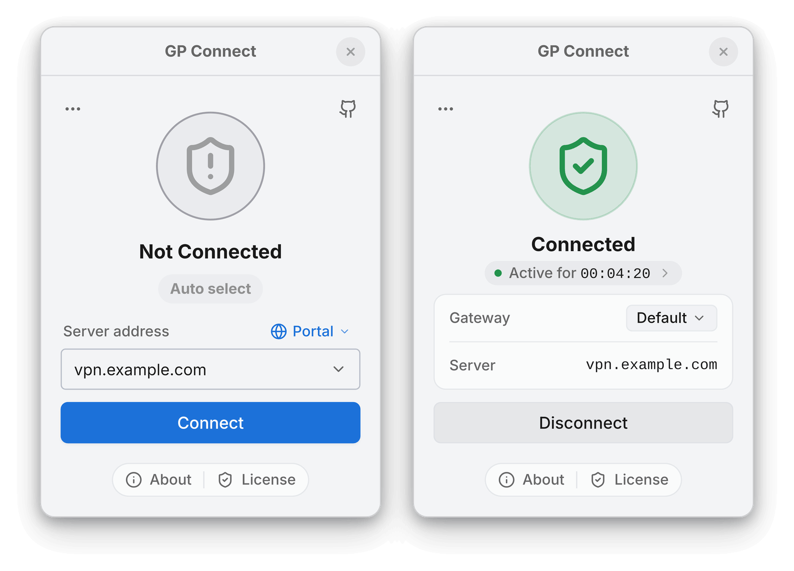

# GlobalProtect-openconnect

**GP Connect** is a GlobalProtect VPN client built on OpenConnect. The desktop app runs on Windows, macOS, Linux, FreeBSD, and OpenBSD. The command-line client is `gpclient`.

[Features](#features) · [Installation](#installation) · [Usage](#usage) · [Troubleshooting](#troubleshooting) · [Building from source](#building-from-source)

<p align="center">
  <picture>
    <source media="(prefers-color-scheme: dark)" srcset="docs/images/gp-connect-showcase-dark.png">
    <source media="(prefers-color-scheme: light)" srcset="docs/images/gp-connect-showcase-light.png">
    
  </picture>
</p>

GP Connect is an independent project. It is not affiliated with or endorsed by Palo Alto Networks, Inc.

## Features

- Browser-based SSO and MFA, including security keys supported by the identity provider. Client certificates are also supported.
- System VPN tunnel or local SOCKS5 and HTTP proxies for individual applications.
- Multiple saved portals and direct gateway connections.
- Built-in host information profile (HIP) reporting and support for custom HIP scripts.
- System tray controls and automatic connection on launch.
- Native Shell, a lightweight desktop interface for supported Linux systems.

## Installation

| Platform | Installation instructions |
| --- | --- |
| Windows and macOS | [Windows](#windows) · [macOS](#macos) |
| Linux | [Alpine](#alpine-linux) · [Arch / Manjaro](#arch-linux--manjaro) · [Debian / Ubuntu](#debian--ubuntu) · [Fedora / RHEL](#fedora--rhel) · [Gentoo](#gentoo) · [NixOS](#nixos) · [openSUSE](#opensuse) · [Other distributions](#other-distributions) |
| BSD | [FreeBSD](#freebsd) · [OpenBSD](#openbsd) |
| Container | [Docker](#docker) |

### Windows

Download the Windows installer for [x64](https://github.com/yuezk/GlobalProtect-openconnect/releases/download/v3.7.0/GPConnect_3.7.0_windows-x64-setup.exe) or [ARM64](https://github.com/yuezk/GlobalProtect-openconnect/releases/download/v3.7.0/GPConnect_3.7.0_windows-arm64-setup.exe). Run it and approve the administrator prompt.

### macOS

Requires Apple silicon and macOS 13+.

#### Homebrew

```bash
brew install --cask yuezk/gp-connect/gp-connect
```

#### DMG installer

Open the [Apple silicon DMG](https://github.com/yuezk/GlobalProtect-openconnect/releases/download/v3.7.0/GPConnect_3.7.0_arm64.dmg) and drag GP Connect into Applications.

### Alpine Linux

Download the APK for [x86_64](https://github.com/yuezk/GlobalProtect-openconnect/releases/download/v3.7.0/globalprotect-openconnect-3.7.0-r1-x86_64.apk) or [ARM64](https://github.com/yuezk/GlobalProtect-openconnect/releases/download/v3.7.0/globalprotect-openconnect-3.7.0-r1-aarch64.apk).

```bash
sudo apk add --allow-untrusted globalprotect-openconnect-*.apk
```

Enable the Alpine `community` repository for WebKitGTK.

### Arch Linux / Manjaro

Install the stable package from the Extra repository.

```bash
sudo pacman -S globalprotect-openconnect
```

For the development version from the main branch, use the AUR package.

```bash
yay -S globalprotect-openconnect-git
```

### Debian / Ubuntu

#### Ubuntu PPA

```bash
sudo add-apt-repository ppa:yuezk/globalprotect-openconnect
sudo apt-get update
sudo apt-get install globalprotect-openconnect
```

#### Debian or Ubuntu release package

Download the DEB for [amd64](https://github.com/yuezk/GlobalProtect-openconnect/releases/download/v3.7.0/globalprotect-openconnect_3.7.0-1_amd64.deb) or [arm64](https://github.com/yuezk/GlobalProtect-openconnect/releases/download/v3.7.0/globalprotect-openconnect_3.7.0-1_arm64.deb).

```bash
sudo apt install ./globalprotect-openconnect_*.deb
```

### Fedora / RHEL

Enable the COPR repository:

```bash
sudo dnf copr enable yuezk/globalprotect-openconnect
sudo dnf install globalprotect-openconnect
```

### Gentoo

Add the overlay:

```bash
sudo emerge --ask app-eselect/eselect-repository dev-vcs/git
sudo eselect repository add yuezk git https://github.com/yuezk/gentoo-overlay.git
sudo emerge --sync yuezk
```

On glibc systems, install the prebuilt package:

```bash
sudo emerge --ask net-vpn/globalprotect-openconnect-bin::yuezk
```

The source package is `net-vpn/globalprotect-openconnect::yuezk`.

If Portage requests keyword or USE flag changes, review and apply them, then rerun the install command.

### NixOS

Add the flake to your `flake.nix`:

```nix
{
  inputs.globalprotect-openconnect.url = "github:yuezk/GlobalProtect-openconnect";

  outputs = { self, nixpkgs, globalprotect-openconnect, ... }: {
    nixosConfigurations.<hostname> = nixpkgs.lib.nixosSystem {
      modules = [
        globalprotect-openconnect.nixosModules.default
        {
          programs.globalprotect-openconnect.enable = true;
        }
      ];
    };
  }
}
```

Apply changes:

```bash
sudo nixos-rebuild switch
```

### openSUSE

Packages are available on the [openSUSE Build Service](https://build.opensuse.org/package/show/home:yuezk/globalprotect-openconnect). Follow the [OBS instructions](https://software.opensuse.org/download.html?project=home%3Ayuezk&package=globalprotect-openconnect) for your distribution.

### Other Distributions

Requires glibc 2.39 or later. Download the archive for [x86_64](https://github.com/yuezk/GlobalProtect-openconnect/releases/download/v3.7.0/globalprotect-openconnect_3.7.0_x86_64.bin.tar.xz) or [ARM64](https://github.com/yuezk/GlobalProtect-openconnect/releases/download/v3.7.0/globalprotect-openconnect_3.7.0_aarch64.bin.tar.xz).

```bash
tar -xJf globalprotect-openconnect_*.bin.tar.xz
cd globalprotect-openconnect_3.7.0
sudo make install
```

### FreeBSD

Download the [FreeBSD package for amd64](https://github.com/yuezk/GlobalProtect-openconnect/releases/download/v3.7.0/globalprotect-openconnect-3.7.0-freebsd-amd64.pkg).

```bash
sudo pkg install ./globalprotect-openconnect-*-freebsd-*.pkg
```

### OpenBSD

Download the [OpenBSD package for amd64](https://github.com/yuezk/GlobalProtect-openconnect/releases/download/v3.7.0/globalprotect-openconnect-3.7.0-openbsd-amd64.tgz).

```bash
doas pkg_add -D unsigned ./globalprotect-openconnect-*-openbsd-*.tgz
```

### Docker

Run the CLI in the project’s Alpine container. Replace `vpn.example.com` with your portal address.

```bash
docker run --rm -it --cap-add=NET_ADMIN --device=/dev/net/tun \
  yuezk/globalprotect-openconnect:latest \
  connect vpn.example.com --browser manual
```

On Linux, add `--network host` to apply VPN routes to the host network.

## Usage

### Desktop

Open **GP Connect**, enter your GlobalProtect portal address, and sign in. On Linux and BSD, you can also launch the app with `gpclient launch-gui`.

### Command line

On Linux, BSD, or macOS with Homebrew, replace `vpn.example.com` with your portal address. Use `doas` instead of `sudo` on OpenBSD.

```sh
sudo gpclient connect vpn.example.com
```

| Command | Action |
| --- | --- |
| `sudo gpclient disconnect` | Disconnect |
| `sudo gpclient connect vpn.example.com --browser` | Sign in with a browser |
| `sudo gpclient connect gateway.example.com --as-gateway` | Connect directly to a gateway |
| `sudo gpclient connect vpn.example.com --hip` | Connect with HIP reporting enabled |

See `gpclient connect --help` for all connection options.

### Connecting over SSH

For portals that allow external-browser sign-in, run this command on the remote host:

```sh
sudo gpclient connect vpn.example.com --browser manual
```

Open the printed URL in a browser that can reach the remote host. After signing in, paste the callback URL into the SSH terminal.

## Troubleshooting

- **Blank Linux window.** Quit GP Connect and run `gpclient launch-gui --interface tauri`. To switch back, quit and rerun with `--interface nsh`.
- **Reporting a problem.** Run `gpclient diagnostics` and include the relevant output in your issue. See the [diagnostics guide](docs/diagnostics.md) for details.

## Building from Source

### Prerequisites (Linux)

- [Rust](https://www.rust-lang.org/tools/install) 1.91 or later
- Build tools: `make`, `pkg-config`, `autoconf`, `automake`, `libtool`, `gettext`
- Libraries: `gmp`, `gnutls`, `nettle`, `libxml2`, `zlib`, `lz4`, `p11-kit`, `libsecret`, and `webkit2gtk-4.1` for the embedded sign-in window and download helper. Native Shell also requires GTK 4.14 or later.
- Polkit (`pkexec`) for privileged tunnel setup

For BSD build requirements, see [Building from Source on FreeBSD and OpenBSD](docs/bsd-source-build.md).

### Build Steps

```bash
git clone --recursive https://github.com/yuezk/GlobalProtect-openconnect.git
cd GlobalProtect-openconnect
make build
sudo make install
```

**Build Options:**

- `INCLUDE_GUI=1` – Download and install the matching desktop application bundle.
- `BUILD_WEBVIEW_AUTH=0` – Disable embedded browser authentication in both `gpclient` and `gpauth`. External-browser and manual sign-in remain available.
- `BUILD_GUI_HELPER=0` – Skip building the helper UI.

## NetworkManager Integration

- [WMP/GlobalProtect-SAML-NetworkManager](https://github.com/WMP/GlobalProtect-SAML-NetworkManager) – NetworkManager VPN plugin with SAML/SSO support for GNOME and KDE Plasma
- [jdpipe/networkmanager-gpclient](https://github.com/jdpipe/networkmanager-gpclient) – NetworkManager VPN plugin that uses `gpclient`

## Licensing

- **CLI (`gpclient`)**: Free and open source (GPL-3.0).
- **GUI (GP Connect)**: Commercial desktop application with a free trial.

### Open Source Components

| Component | Type | License |
|-----------|------|---------|
| [gpapi](./crates/gpapi) | Crate | [MIT](./crates/gpapi/LICENSE) |
| [openconnect](./crates/openconnect) | Rust wrapper crate | [MIT](./crates/openconnect/LICENSE) |
| [upstream OpenConnect](./crates/openconnect/deps/openconnect) | C library | [LGPL-2.1](./crates/openconnect/deps/openconnect/COPYING.LGPL) |
| [common](./crates/common) | Crate | [MIT](./crates/common/LICENSE) |
| [browser-launcher](./crates/browser-launcher) | Crate | [MIT](./crates/browser-launcher/LICENSE) |
| [auth](./crates/auth) | Crate | [GPL-3.0](./crates/auth/LICENSE) |
| [gpservice](./apps/gpservice) | Application | [GPL-3.0](./apps/gpservice/LICENSE) |
| [gpclient](./apps/gpclient) | Application | [GPL-3.0](./apps/gpclient/LICENSE) |
| [gpauth](./apps/gpauth) | Application | [GPL-3.0](./apps/gpauth/LICENSE) |
| [gpgui-helper](./apps/gpgui-helper) | Application | [GPL-3.0](./apps/gpgui-helper/LICENSE) |

## Acknowledgments

Inspired by [gp-saml-gui](https://github.com/dlenski/gp-saml-gui).
