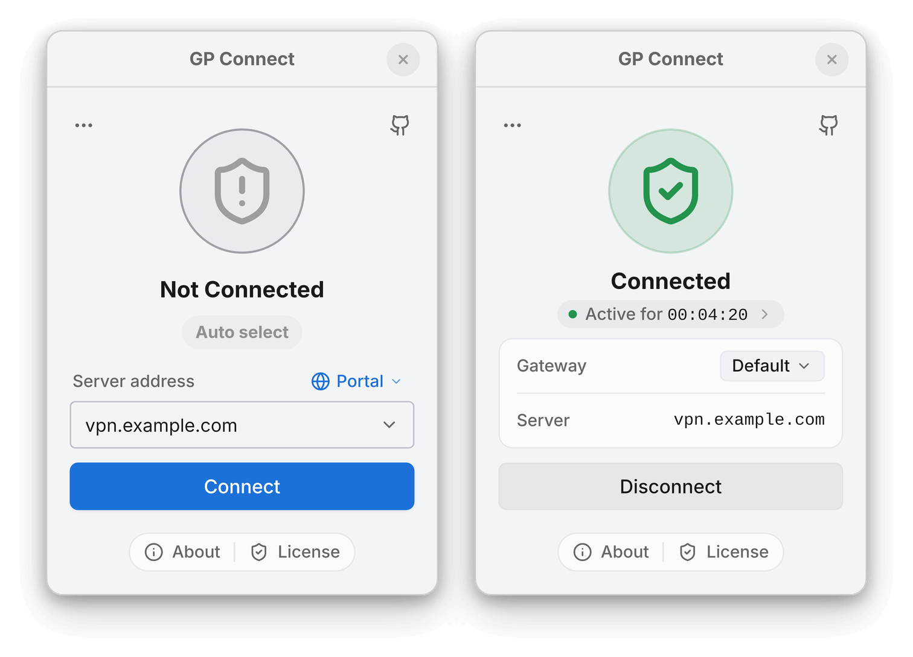

# GlobalProtect-openconnect

A GlobalProtect VPN client built on OpenConnect. It provides command-line tools (`gpclient`) and the GP Connect desktop application for macOS, Linux, FreeBSD, and OpenBSD.

> **Disclaimer**: GP Connect is an independent third-party client for GlobalProtect VPN networks. It is not affiliated with or endorsed by Palo Alto Networks, Inc.

<p align="center">
  <picture>
    <source media="(prefers-color-scheme: dark)" srcset="docs/images/gp-connect-showcase-dark.png">
    <source media="(prefers-color-scheme: light)" srcset="docs/images/gp-connect-showcase-light.png">
    
  </picture>
</p>

> **Inspired by** [gp-saml-gui](https://github.com/dlenski/gp-saml-gui)

## Table of Contents

- [Features](#features)
- [Usage](#usage)
  - [Command-Line Interface](#command-line-interface)
  - [Graphical User Interface](#graphical-user-interface)
- [Installation](#installation)
  - [macOS](#macos)
  - [Debian / Ubuntu](#debian--ubuntu)
  - [Arch Linux / Manjaro](#arch-linux--manjaro)
  - [Fedora / RHEL](#fedora--rhel)
  - [openSUSE](#opensuse)
  - [Alpine Linux](#alpine-linux)
  - [FreeBSD](#freebsd)
  - [OpenBSD](#openbsd)
  - [Gentoo](#gentoo)
  - [NixOS](#nixos)
  - [Docker](#docker)
  - [Other Distributions](#other-distributions)
- [Building from Source](#building-from-source)
- [Troubleshooting](#troubleshooting)
- [NetworkManager Integration](#networkmanager-integration)
- [Licensing](#licensing)

## Features

- **Multi-Platform** – macOS (Apple silicon), Linux, FreeBSD, and OpenBSD
- **Dual Interfaces** – Fast terminal CLI (`gpclient`) and desktop GUI (**GP Connect**)
- **Native Shell on Linux** – Ultra-low-memory native desktop GUI alongside the webview interface
- **Flexible Routing** – Full System VPN tunnel or local SOCKS5 proxy mode
- **Modern Authentication** – SAML / SSO, MFA, FIDO2 (YubiKey), client certificates, and external browser login
- **Automated HIP Reports** – Built-in HIP report generation or custom scripts
- **Multi-Portal & Direct Gateway** – Manage multiple saved portals or connect directly to a gateway
- **Desktop Integration** – Theme-aware system tray icon, auto-connect on launch, and reconnect on wake

## Usage

### Command-Line Interface

The open-source `gpclient` CLI handles authentication, connection lifecycle, and HIP generation:

```bash
# Connect to a portal server
sudo gpclient connect <portal>

# Connect using browser authentication (SSO / SAML)
sudo gpclient connect <portal> --browser

# Connect directly to a gateway server
sudo gpclient connect <gateway> --as-gateway

# Connect with automatic HIP report generation
sudo gpclient connect <portal> --hip

# Headless / remote server authentication (prints auth URL to open in any browser)
sudo gpclient connect <portal> --browser manual

# Disconnect
sudo gpclient disconnect
```

Run `gpclient --help` or `gpclient <command> --help` to view all available commands and options.

### Graphical User Interface

- **macOS**: Open **GP Connect** from Applications.
- **Linux / BSD**: Launch GP Connect from your application menu or run:
  ```bash
  gpclient launch-gui
  ```

> [!TIP]
> **On Linux, try Native Shell for lower memory usage.** Switch between Native Shell and Tauri in **Settings → General → Interface**.

## Installation

### macOS

Requires Apple silicon and macOS 13+. Includes both GP Connect and the `gpclient` CLI.

#### Option 1: Homebrew (Recommended)

```bash
brew install --cask yuezk/gp-connect/gp-connect
```

#### Option 2: DMG Installer

Download the `.dmg` from the [releases](https://github.com/yuezk/GlobalProtect-openconnect/releases) page and drag GP Connect into Applications.

### Debian / Ubuntu

#### Option 1: PPA (Recommended)

```bash
sudo add-apt-repository ppa:yuezk/globalprotect-openconnect
sudo apt-get update
sudo apt-get install globalprotect-openconnect
```

#### Option 2: DEB Package

Download the latest `.deb` from the [releases](https://github.com/yuezk/GlobalProtect-openconnect/releases) page:

```bash
sudo apt install ./globalprotect-openconnect_*.deb
```

### Arch Linux / Manjaro

```bash
# Official Extra repository
sudo pacman -S globalprotect-openconnect

# AUR (git main)
yay -S globalprotect-openconnect-git
```

### Fedora / RHEL

Enable the COPR repository:

```bash
sudo dnf copr enable yuezk/globalprotect-openconnect
sudo dnf install globalprotect-openconnect
```

### openSUSE

Packages are available on the [openSUSE Build Service](https://build.opensuse.org/package/show/home:yuezk/globalprotect-openconnect). Follow the [OBS instructions](https://software.opensuse.org/download.html?project=home%3Ayuezk&package=globalprotect-openconnect) for your distribution.

### Alpine Linux

Download the latest `.apk` package from the [releases](https://github.com/yuezk/GlobalProtect-openconnect/releases) page:

```bash
sudo apk add --allow-untrusted globalprotect-openconnect-*.apk
```

*(Requires `community` repository enabled for WebKitGTK and AppIndicator dependencies).*

### FreeBSD

Download the latest FreeBSD package from the [releases](https://github.com/yuezk/GlobalProtect-openconnect/releases) page:

```bash
sudo pkg install ./globalprotect-openconnect-*-freebsd-*.pkg
```

### OpenBSD

Download the latest OpenBSD package from the [releases](https://github.com/yuezk/GlobalProtect-openconnect/releases) page:

```bash
doas pkg_add -D unsigned ./globalprotect-openconnect-*-openbsd-*.tgz
```

### Gentoo

Available via the `guru` repository:

```bash
sudo eselect repository enable guru
sudo emerge --sync guru
sudo emerge --ask net-vpn/GlobalProtect-openconnect
```

### NixOS

Add the flake to your `flake.nix`:

```nix
{
  inputs.globalprotect-openconnect.url = "github:yuezk/GlobalProtect-openconnect";

  outputs = { self, nixpkgs, globalprotect-openconnect, ... }: {
    nixosConfigurations.<hostname> = nixpkgs.lib.nixosSystem {
      modules = [
        globalprotect-openconnect.nixosModules.default
        {
          programs.globalprotect-openconnect.enable = true;
        }
      ];
    };
  }
}
```

Apply changes:

```bash
sudo nixos-rebuild switch
```

### Docker

Run the CLI client in an official Alpine container:

```bash
docker run --rm -it --cap-add=NET_ADMIN --device=/dev/net/tun \
  yuezk/globalprotect-openconnect:latest \
  connect <portal> --browser manual
```

*(Add `--network host` on Linux if VPN routes should apply to the host network).*

### Other Distributions

Download `globalprotect-openconnect_${version}_${arch}.bin.tar.xz` from the [releases](https://github.com/yuezk/GlobalProtect-openconnect/releases) page:

```bash
tar -xJf globalprotect-openconnect_*.bin.tar.xz
cd globalprotect-openconnect_*
sudo make install
```

## Building from Source

### Prerequisites (Linux)

- [Rust](https://www.rust-lang.org/tools/install) 1.91 or later
- Build tools: `make`, `pkg-config`, `autoconf`, `automake`, `libtool`, `gettext`
- Libraries: `gmp`, `gnutls`, `nettle`, `libxml2`, `zlib`, `lz4`, `p11-kit`, `libsecret`, and `webkit2gtk-4.1` (or GTK 4 for Native Shell)
- Polkit (`pkexec`) for privileged tunnel setup

*(For FreeBSD and OpenBSD instructions, see [Building from Source on FreeBSD and OpenBSD](docs/bsd-source-build.md)).*

### Build Steps

```bash
git clone --recursive https://github.com/yuezk/GlobalProtect-openconnect.git
cd GlobalProtect-openconnect
make build
sudo make install
```

**Build Options:**

- `INCLUDE_GUI=1` – Download and install the matching desktop application bundle.
- `BUILD_WEBVIEW_AUTH=0` – Build `gpauth` without embedded browser authentication (uses external browser or manual mode).
- `BUILD_GUI_HELPER=0` – Skip building the helper UI.

## Troubleshooting

- **Headless / Remote Login**: When running without a desktop display or over SSH, use `--browser manual`. Open the printed URL in any browser and paste the callback URL back into the terminal.
- **Diagnostics**: If you encounter issues, run `gpclient diagnostics` or follow the [diagnostics guide](docs/diagnostics.md) when opening an issue.

## NetworkManager Integration

- [WMP/GlobalProtect-SAML-NetworkManager](https://github.com/WMP/GlobalProtect-SAML-NetworkManager) – NetworkManager VPN plugin with SAML/SSO support for GNOME and KDE Plasma
- [jdpipe/networkmanager-gpclient](https://github.com/jdpipe/networkmanager-gpclient) – NetworkManager VPN plugin that uses `gpclient`

## Licensing

- **CLI (`gpclient`)**: Free and open source (GPL-3.0).
- **GUI (GP Connect)**: Commercial desktop application with a free trial.

### Open Source Components

| Component | Type | License |
|-----------|------|---------|
| [gpapi](./crates/gpapi) | Crate | [MIT](./crates/gpapi/LICENSE) |
| [openconnect](./crates/openconnect) | Rust wrapper crate | [MIT](./crates/openconnect/LICENSE) |
| [upstream OpenConnect](./crates/openconnect/deps/openconnect) | C library | [LGPL-2.1](./crates/openconnect/deps/openconnect/COPYING.LGPL) |
| [common](./crates/common) | Crate | [MIT](./crates/common/LICENSE) |
| [browser-launcher](./crates/browser-launcher) | Crate | [MIT](./crates/browser-launcher/LICENSE) |
| [auth](./crates/auth) | Crate | [GPL-3.0](./crates/auth/LICENSE) |
| [gpservice](./apps/gpservice) | Application | [GPL-3.0](./apps/gpservice/LICENSE) |
| [gpclient](./apps/gpclient) | Application | [GPL-3.0](./apps/gpclient/LICENSE) |
| [gpauth](./apps/gpauth) | Application | [GPL-3.0](./apps/gpauth/LICENSE) |
| [gpgui-helper](./apps/gpgui-helper) | Application | [GPL-3.0](./apps/gpgui-helper/LICENSE) |
